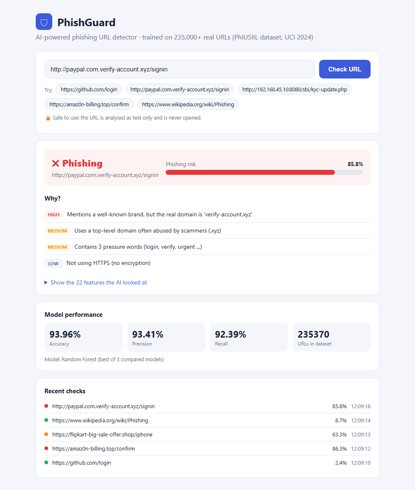

# 🛡️ PhishGuard – AI-Powered Phishing URL Detector

PhishGuard uses **machine learning** to detect phishing websites just by looking at their URL.
It's trained on **235,000+ real URLs** from the PhiUSIIL dataset (UCI Machine Learning Repository, 2024).
Paste any link into the web app and it tells you whether the link is **Safe**, **Suspicious** or **Phishing**.
It also gives you a risk score and explains **why** in plain English.

> 🔒 The URL is analysed as text only and is never opened, so checking a dangerous link is safe.

### 🌐 [Try the live demo →](https://priyanshtiwariinfosec.github.io/phishguard/)
It runs 100% in your browser, with nothing to install, and no URL is ever sent anywhere.



---

## ✨ Features

- **Trained on real-world data**: 134,850 legitimate and 100,520 phishing URLs
- **Discovers and fixes dataset bias (shortcut learning)**: see the section below. This is the key finding of the project.
- **Hybrid detection**: a verified-brand allowlist plus a Random Forest ML model
- **22 hand-crafted URL features**: IP-address URLs, brand impersonation, look-alike characters (`amaz0n`, `rnicrosoft`), suspicious TLDs, pressure words, URL shorteners, `@` tricks, punycode, hidden redirects, randomness (entropy) and more
- **Comparison of 3 ML models**: Logistic Regression, Decision Tree and Random Forest
- **Explainable AI**: every verdict comes with human-readable reasons, each with a severity level
- **Web dashboard (Flask)**, **REST API** and **command-line tool**
- **Live browser demo (GitHub Pages)**: a JavaScript port of the feature extractor runs a compact 40-tree model client-side. It's verified to produce identical features on 3,041 test URLs.
- **Shareable check links**: `?url=<link>` checks that link automatically (in both the web app and the live demo)
- **Secure by design**: XSS-safe rendering and input length limits; URLs are never fetched

---

## 🏗️ Architecture

```
                ┌─────────────────────┐
  User types ─► │  Web UI / CLI / API  │
    a URL       └──────────┬──────────┘
                           ▼
                ┌─────────────────────┐
                │  Feature extractor   │  features.py
                │  URL ─► 22 numbers   │
                └──────────┬──────────┘
                           ▼
                ┌─────────────────────┐
                │  Random Forest       │  model/phishing_model.joblib
                │  (150 trees vote)    │  ─► probability of phishing
                └──────────┬──────────┘
                           ▼
                ┌─────────────────────┐
                │  Allowlist layer     │  Is the registered domain an official
                │                      │  brand domain? (web.whatsapp.com ✔,
                │                      │  whatsapp.com.evil.xyz ✘)
                └──────────┬──────────┘
                           ▼
                ┌─────────────────────┐
                │  Verdict + risk %    │  SAFE < 40% ≤ SUSPICIOUS < 70% ≤ PHISHING
                │  + explanations      │
                └─────────────────────┘
```

---

## 📁 Project structure

```
phishing-url-detector/
├── features.py               # converts a URL into 22 numeric features + explanations
├── prepare_real_dataset.py   # converts + DEBIASES the real PhiUSIIL dataset
├── generate_dataset.py       # optional synthetic dataset (used for early prototyping)
├── train.py                  # trains & compares 3 models, runs the real-world check, saves the best
├── predict.py                # hybrid detector (allowlist + ML), command-line checker
├── app.py                    # Flask web app + REST API
├── export_web_model.py       # trains + exports the compact model for the live demo
├── docs/                     # live demo (GitHub Pages): index.html, phishguard.js, model.json
├── templates/index.html      # web dashboard
├── requirements.txt
├── model/                    # final trained model + metrics.json (included)
├── data/                     # datasets (not in the repo - created by the steps below)
└── model_raw/                # biased comparison model (not in the repo - see "Key finding")
```

---

## 🚀 How to run

### Quick start (uses the included trained model)
```bash
git clone https://github.com/priyanshtiwariinfosec/phishguard.git
cd phishguard
pip install -r requirements.txt
python app.py
```
Then open **http://127.0.0.1:5000**.

### Retrain from scratch (optional)

**1. Install the libraries** (needs Python 3.9 or newer)
```bash
pip install -r requirements.txt
```

**2. Download the dataset.** Get the zip (14.7 MB) from
https://archive.ics.uci.edu/dataset/967/phiusiil+phishing+url+dataset
and extract `PhiUSIIL_Phishing_URL_Dataset.csv` into `data/raw/`.

**3. Prepare the data and train**
```bash
python prepare_real_dataset.py
python train.py
```

**4. Start the web app**
```bash
python app.py
```
Then open **http://127.0.0.1:5000** in your browser.

**Command line:**
```bash
python predict.py "http://paypal.com.verify-account.xyz/signin" "https://github.com"
```

**API:**
```bash
curl -X POST http://127.0.0.1:5000/api/check -H "Content-Type: application/json" -d "{\"url\": \"https://amaz0n-billing.top/confirm\"}"
```

---

## 📚 Dataset

**PhiUSIIL Phishing URL Dataset.** Prasad, A. & Chandra, S. (2024). *PhiUSIIL: A diverse security profile empowered phishing URL detection framework based on similarity index and incremental learning.* Computers & Security. [UCI ML Repository](https://archive.ics.uci.edu/dataset/967/phiusiil+phishing+url+dataset), license CC BY 4.0.

- 235,795 rows → 235,370 after removing duplicate URLs
- ⚠️ The dataset's labels are **reversed**: in PhiUSIIL, `1` = legitimate. `prepare_real_dataset.py` flips them so that `1` = phishing.

---

## 🔍 Key finding: the dataset bias trap (shortcut learning)

While exploring the data, I found that **every one** of the 134,850 legitimate URLs has the exact form `https://www.<domain>`:

| | Legitimate URLs | Phishing URLs |
|---|---|---|
| Start with `https://` | **100%** | 48.7% |
| Start with `www.` | **100%** | 41.4% |
| Have a path (`/login`, `/about` …) | **0%** | 27.2% |

Real legitimate websites obviously do have paths (`github.com/login`) and subdomains (`docs.python.org`).
So a model trained on the raw data learns a **shortcut**: *"has a path or no www. → phishing"*.

**Proof.** I trained on the raw data and tested on 30 everyday URLs (15 real sites, 15 phishing-style). The raw model scored **99.78% test accuracy**, yet it **flagged every single real website as phishing**, including GitHub, Wikipedia, YouTube and PayPal. The high accuracy was an illusion.

**Fix (`prepare_real_dataset.py`).** Label-preserving data augmentation of the legitimate URLs:
1. Remove `www.` from all URLs, so it can't be used as a shortcut
2. Add realistic paths to 60% of the legitimate URLs (a real site with a path is still a real site)
3. Add common subdomains (`docs.`, `mail.`, `accounts.` …) to 30% of them
4. Switch 10% of them to `http://`

### 📊 Results

| Model | Training data | Test accuracy | Real-world check (30 URLs) |
|---|---|---|---|
| Random Forest | Raw PhiUSIIL (biased) | 99.78% | **15/30** ❌ (every real site flagged) |
| Random Forest | Debiased PhiUSIIL | 93.96% | **29/30** ✅ |
| **Random Forest + allowlist (final)** | Debiased PhiUSIIL | 93.96% | **30/30** ✅ |

Final model comparison on the debiased data (47,074 test URLs the model never saw):

| Model | Accuracy | Precision | Recall | F1-score |
|---|---|---|---|---|
| Logistic Regression | 84.78% | 83.53% | 80.17% | 81.82% |
| Decision Tree | 91.72% | 92.11% | 88.15% | 90.09% |
| **Random Forest** ✅ | **93.96%** | **93.41%** | **92.39%** | **92.90%** |

**Lesson:** lower accuracy on an honest test is better than 99.78% on a biased one. Always test your model on real-world examples, not just on a split of the same dataset.

**Independent check.** On 16 brand-new URLs that were never used while tuning, the ML model alone got 15/16 right. The one miss was `web.whatsapp.com`, which the allowlist layer now handles.

> Note: the 30-URL real-world check was also used while developing the debiasing steps, so treat it as a development check, not a fully independent test.

---

### 🌐 Live demo model

The browser demo uses a compact Random Forest (40 trees, depth 12, 1.1 MB) trained on the same debiased data and split:

| Model | Size | Accuracy | Precision | Recall | Real-world check |
|---|---|---|---|---|---|
| Full model (Python app) | 33 MB | 93.96% | 93.41% | 92.39% | 30/30 |
| Compact model (live demo) | 1.1 MB | 92.65% | 93.37% | 89.12% | 30/30 |

`docs/phishguard.js` re-implements the feature extractor in JavaScript. It mimics Python's `urlparse`, code-point string lengths, round-half-to-even and scikit-learn's float32 comparisons. On 3,041 test URLs, all 22 features were identical to Python's, the probabilities differed by less than 0.000002, and all 434 explanations matched exactly. Run `python export_web_model.py --fixture docs/parity_fixture.json` to regenerate the parity test data.

---

## ⚠️ Limitations

- It only looks at the URL text, not the page content, the SSL certificate or the domain age (WHOIS).
- The debiasing paths and subdomains are generated, so they are an approximation of real legitimate URLs.
- The allowlist only covers ~25 brands. Phishing hosted on an allowlisted platform (for example a malicious Google Form) would be marked safe.
- New phishing patterns not seen in the dataset can slip through.

## 🔮 Future scope

- Collect real legitimate URLs with paths (for example from Common Crawl) instead of generating them
- Add **WHOIS domain age** and **SSL certificate** checks
- Analyse **page content** (login forms, copied logos) with NLP or computer vision
- Build a **browser extension** that warns before opening a link
- Try **deep learning** (character-level CNN/LSTM) on raw URLs
- Integrate live threat feeds (PhishTank, Google Safe Browsing API)

---

## 🎓 Viva / interview questions

**Q: What is phishing?**
A social-engineering attack where a fake website imitates a trusted brand to steal passwords, card details or OTPs.

**Q: Your raw model had 99.78% accuracy. Why didn't you use it?**
Because it cheated. The dataset's legitimate URLs never have paths, so the model learned "path → phishing" and flagged real sites like github.com/login. This is called **shortcut learning** (or dataset bias). It only showed up when I tested on real-world URLs outside the dataset.

**Q: How did you fix the bias?**
With label-preserving data augmentation: I removed `www.` from every URL and added realistic paths and subdomains to legitimate URLs. Adding `/about` to a real website keeps it legitimate, so the labels stay correct.

**Q: Why Random Forest?**
It combines 150 decision trees that vote, which reduces overfitting. It handles mixed features without scaling, shows which features matter most, and had the best F1 of the three models.

**Q: Why combine an allowlist with ML?**
That's a hybrid approach, like real security products use. ML generalises to new attacks, and the allowlist prevents false alarms on official brand domains. The allowlist checks the **registered domain** exactly, so `paypal.com.evil.xyz` and `paypal.com@evil.top` are not fooled by it.

**Q: Why is recall important here?**
Recall is the share of real phishing URLs we catch. Missing a phishing link (a false negative) is more dangerous than wrongly flagging a safe link.

**Q: What is entropy?**
Shannon entropy measures how random a string is. Machine-generated domains like `qx7kz9wpt3vbn.xyz` have high entropy.

**Q: How did you make the web app itself secure?**
All user input is shown using `textContent` (never `innerHTML`) to prevent XSS. URL length is limited, and the app never visits the submitted URL, which avoids SSRF and drive-by downloads.
